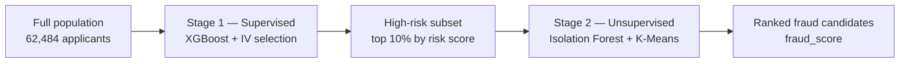

# 📌 Fraud Detection Model

A two-stage pipeline for surfacing likely fraud inside a credit-application dataset that only has **default** labels, not fraud labels — combining a supervised risk filter with unsupervised anomaly detection.

> Originally built for the American Express Campus Challenge 2024 (Strategy Track, top 15 of 600+ teams). This version fixes a data-leakage bug in the original feature selection and implements the anomaly-detection stage that the original write-up described but never shipped in code.

---

## Table of Contents

- [The Problem](#the-problem)
- [Approach](#approach)
- [Results](#results)
- [Getting Started](#getting-started)
- [Project Structure](#project-structure)
- [What Was Fixed](#what-was-fixed-from-the-original-version)
- [Limitations & Next Steps](#limitations--next-steps)

---

## The Problem

The dataset labels `default_ind` (did this applicant default on their credit line?) — it does **not** label fraud. In reality:

- Most defaulters are simply over-leveraged or hit financial hardship — not fraudsters.
- Fraud is a **hidden minority within the defaulter population**: every fraudster eventually defaults, but not every defaulter is a fraudster.
- There is no ground-truth fraud label anywhere in this dataset, so results can only be sanity-checked against the weak `default_ind` proxy, not formally validated.

This makes it a weakly-supervised + anomaly-detection problem rather than a standard classification task.

## Approach



**Stage 1 — supervised weak-risk filter.** XGBoost trained on `default_ind`, with Information Value (IV) feature selection and SHAP explainability. This is *not* a fraud classifier — its only job is to narrow the population down to a high-risk region where fraud is more likely to be hiding.

**Stage 2 — unsupervised anomaly discovery.** On the Stage-1 high-risk subset, two anomaly detectors run in parallel and are blended into a single `fraud_score`:
- **Isolation Forest** — global outliers (patterns far from the bulk of the high-risk group)
- **K-Means** — local outliers (distance from a point to its own cluster centroid, i.e. unusual relative to its peer group)

```
fraud_score = 0.5 × global_score + 0.5 × local_score
```

## Results

All numbers below are reproducible by running `python src/run_pipeline.py` — nothing is hand-copied from a slide deck.

**Stage 1** (XGBoost, IV-selected features, SMOTE on train only, evaluated on an untouched 20% test split):

| Metric | Value |
|---|---|
| Accuracy | 99.47% |
| ROC-AUC | 0.954 |
| Precision (default = 1) | 0.585 |
| Recall (default = 1) | 0.329 |
| F1 (default = 1) | 0.421 |

Read this honestly: accuracy/AUC look strong mostly because the dataset is >99% negative class. Recall on the rare positive class (~33%) is the number that actually matters at a 0.58% base rate, and it's realistic for a proxy-labeled problem like this one.

**Stage 2** (`fraud_score` sanity-checked against `default_ind`, since no fraud label exists):

| Group | Default rate | Lift vs. population |
|---|---|---|
| Full population | 0.58% | 1.0x |
| Stage-1 high-risk subset (top 10%) | 5.6% | 9.7x |
| Top 100 by `fraud_score` | 13.0% | 22.4x |
| Top 500 by `fraud_score` | 18.2% | 31.3x |

This shows the pipeline meaningfully concentrates risk — but since `default_ind` conflates fraud with ordinary non-payment, `fraud_score` should be treated as a **prioritization tool for analyst review**, not a validated fraud detector.

## Getting Started

```bash
git clone <your-repo-url>
cd Fraud-Detection-Model
pip install -r requirements.txt
python src/run_pipeline.py
```

This regenerates everything under `outputs/`:

| File | Contents |
|---|---|
| `outputs/reports/data_quality.csv` | Missingness, sentinel values, cardinality per column |
| `outputs/reports/iv_table.csv` | Information Value per feature (train split only) |
| `outputs/reports/stage1_metrics.json` | Stage 1 model metrics on the held-out test set |
| `outputs/reports/stage1_feature_importance.csv` | XGBoost feature importances |
| `outputs/reports/fraud_candidates.csv` | Stage 2 ranked fraud candidates |
| `outputs/reports/stage2_sanity_check.json` | Lift of `fraud_score` vs. `default_ind` |
| `outputs/shap_plots/*.png` | SHAP summary plots |

Or open [`notebooks/fraud_detection_pipeline.ipynb`](notebooks/fraud_detection_pipeline.ipynb) for the same pipeline with inline plots and commentary — it's committed pre-executed, so the real results are visible on GitHub without running anything.

## Project Structure

```
Fraud-Detection-Model/
├── README.md
├── requirements.txt
├── data/
│   └── 66acd42635424_r3_data.csv       # 62,484 applicants x 61 features
├── src/
│   ├── data_prep.py                    # loading + data-quality report
│   ├── iv_selection.py                 # Information Value, train-only
│   ├── stage1_supervised.py            # XGBoost + SMOTE + evaluation
│   ├── stage2_unsupervised.py          # Isolation Forest + K-Means dual score
│   └── run_pipeline.py                 # end-to-end orchestration script
├── notebooks/
│   └── fraud_detection_pipeline.ipynb  # same pipeline, executed, with plots
├── outputs/
│   ├── reports/                        # csv/json outputs
│   └── shap_plots/                     # SHAP summary plots
└── docs/
    └── methodology.md                  # detailed write-up of the approach
```


## Limitations & Next Steps

- No ground-truth fraud labels exist in this dataset, so this is a risk-prioritization pipeline sanity-checked against a proxy label — not a validated fraud classifier.
- Class imbalance is severe (0.58% positive rate); Stage 1 recall/precision will always trade off sharply at this base rate.
- Categorical fields (`prod_name`, `acq_channel`, `state_code`, `bureau_src`, `appl_month`) aren't used by the current numeric-only models — encoding them is a natural next step.
- Stage 2 hyperparameters (top-10% high-risk cutoff, `alpha = 0.5` blend weight, `n_clusters = 8`) are reasonable defaults, not tuned against a labeled validation set.

---

*See [`docs/methodology.md`](docs/methodology.md) for the full technical write-up.*
